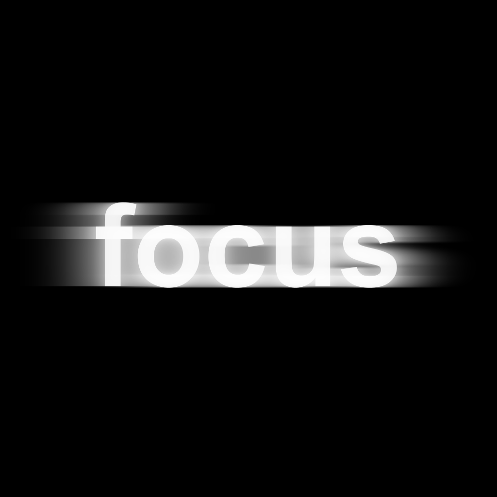

<p align="center"></p>

# focus

App Android per seguire la scheda di allenamento in palestra: un esercizio alla volta, a caratteri grandi, un solo tap per serie, schermo sempre acceso durante l'allenamento.

## Installazione

1. Scarica `focus-x.y.apk` (fino alla 1.2: `scheda-x.y.apk`) dalla pagina **Releases** del repository, direttamente dal telefono.
2. Aprilo. Android chiederà di consentire a quell'app (browser o file manager) di **installare app sconosciute**: consentilo solo per questa installazione.
3. Richiede Android 8.0 o successivo.

L'APK è firmato con una chiave di debug: va bene per uso personale, non per il Play Store.

## Aggiornamenti

Dalla versione 1.1 l'app controlla da sola, all'avvio, se su GitHub Releases c'è una versione nuova. Se c'è, in Home compare **Aggiorna**: l'app scarica l'APK e Android chiede conferma. Se il telefono blocca l'aggiornamento diretto (per esempio con «Self update is blocked»), dalla 1.3.1 l'app apre l'installer di sistema; se non va neanche quello, apre la pagina della release. La prima volta Android chiede anche di consentire a focus di installare app sconosciute. In fondo alla Home c'è anche **Controlla aggiornamenti**. La scheda salvata resta.

Per pubblicare una nuova versione: aumenta `versionCode` e `versionName` in `app/build.gradle.kts`, compila, crea una release con tag `vX.Y` e allega l'APK. L'APK deve essere firmato con **la stessa chiave** della versione installata, altrimenti Android rifiuta l'aggiornamento.

## Uso

- **Home**: una pagina per ogni giorno, colorata in base ai muscoli. Scorri o usa la barra in vetro in basso per cambiare giorno. All'apertura l'app è già sul giorno di oggi (se oggi è riposo, sul prossimo allenamento; se ne hai uno lasciato a metà, su quello). Ogni pagina mostra l'elenco degli esercizi e il pulsante **Inizia allenamento**.
- **Allenamento**: una card col colore del gruppo muscolare mostra esercizio, ripetizioni (`10 ripetizioni` oppure `A cedimento`) e un anello con la serie a cui sei; sotto, cosa viene dopo. In alto un segmento per ogni esercizio.
  - **Serie fatta**: il pulsante grande in basso. All'ultima serie passa da solo all'esercizio successivo.
  - **Annulla serie**: torna indietro di una serie (compare dopo la prima).
  - **Salta esercizio**: passa al successivo.
  - **Esci**: torna alla home. L'allenamento resta "in corso" e lo riprendi toccando lo stesso giorno.
- **Recupero**: dopo ogni serie parte da solo il timer (90 s di base, oppure quello scritto nella nota: `rec 60`, `rec 1:30`, `rec 2'`, `recupero 2 min`). Allo zero il telefono vibra. −15/+15 lo regolano, **Inizia serie** lo salta.
  - **Tasto volume giù**: fa la stessa cosa del pulsante grande (serie fatta / inizia serie), senza guardare lo schermo.
  - **Peso**: ±2,5 kg sulla card; l'app ricorda l'ultimo peso di ogni esercizio e lo mostra anche in Home.
  - **Fine allenamento**: riepilogo con durata, serie, esercizi e orario di inizio e fine.
- **Settimana**: nella barra in basso compare ✓ sui giorni già fatti questa settimana (da lunedì).
- **Scorciatoia**: tieni premuta l'icona dell'app → **Allenamento di oggi** apre la scheda del giorno. L'allenamento parte solo quando tocchi **Inizia**.
- Lo schermo resta acceso solo nella schermata di allenamento.
- L'app si apre sempre sulla Home. Se avevi un allenamento a metà, trovi **Riprendi** e ricominci dall'esercizio e dalla serie dove eri.

## Modificare la scheda

Dalla home tocca **Modifica scheda**. Puoi incollare il testo dalle note oppure importare un file `.txt`. L'anteprima mostra cosa è stato riconosciuto prima di salvare.

Formato riconosciuto (puntini `•`, trattini e righe vuote vengono ignorati):

```
Monday Upper Body Focus     ← titolo: inizia un nuovo allenamento
• Lunedì                    ← riga subito dopo il titolo: nome mostrato sul pulsante
• Petto:                    ← termina con ":" = gruppo muscolare
• Panca Piana 3x10          ← esercizio: serie x ripetizioni
• Shoulder Machine 3xF      ← F = a cedimento
• Squat 4x8-10 80kg rec 90  ← intervalli e note dopo le ripetizioni sono ammessi
```

Una riga che non contiene `NxM` e non termina con `:` viene letta come titolo di un nuovo allenamento. Controlla l'anteprima.

## Compilare da sorgente

Servono JDK 17+ e l'Android SDK (platform 37).

```bash
./gradlew testDebugUnitTest assembleRelease
```

L'APK viene generato in `app/build/outputs/apk/release/app-release.apk`.

Stack: Kotlin, Jetpack Compose (`Modifier.keepScreenOn()`, Compose UI ≥ 1.9) e [Haze](https://github.com/chrisbanes/haze) per l'effetto vetro della navbar (rifrazione completa da Android 13, versione semplificata sui precedenti). Permessi: `INTERNET` e `REQUEST_INSTALL_PACKAGES` (solo per gli aggiornamenti), `VIBRATE` (fine recupero).

Il logo si rigenera con `java tools/Logo.java app/src/main/res docs`.

Gli screenshot delle schermate si rigenerano con `./gradlew testDebugUnitTest --tests "*ScreenshotTest*"` e finiscono in `app/build/shots/`.
